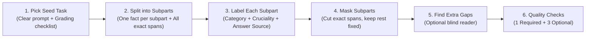
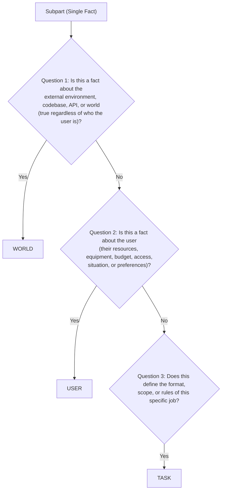

# Stage 1 Methodology: Building the Ambiguous Instruction Dataset

This guide explains how to turn clear, complete task instructions into controlled ambiguous instructions with a verified answer key (the **Reference Set** of missing details).

---

## Overview of the Pipeline



---

## Step 1: Select Qualified Seed Tasks

Do not start from vague prompts. Start from **clear, fully specified tasks** (from an existing benchmark or curated task bank) that meet four rules:

1. **Multi-Step Execution:** The agent must make decisions or use tools to finish the task (not a one-word trivia question).
2. **Grading Checklist Exists:** The task has a clear grading script, unit test, or checklist that grades whether the final output is right or wrong.
3. **Room to Assume and Act:** When a detail is removed, the agent **can still try to finish the task** by making a default assumption (unlike a math equation where removing a number makes calculation impossible).
4. **Mix of Details (Dataset Level):** Across the full dataset, the instructions contain details about the **World**, the **User**, and the **Task**. A single seed task does **not** need all three. Each seed task needs **at least one Crucial subpart** (see Step 3).

### Rule 3 in Practice: The 3-Question Test
Rule 3 asks: **after we remove the detail, can the agent still finish in a sensible way?** The removed detail must be a **setting** of the task, not its **goal**. Ask three questions:

1. **Is It Still the Same Task?** Remove the detail and read the instruction again. If the job changed or disappeared, the item fails.
2. **Is There a Short List of Reasonable Values?** There are about 2–5 realistic values, and you could write a working solution for each one.
3. **Would a Good Engineer Start Working?** Without the detail, a competent developer would make a sensible pick and keep going, instead of getting stuck.

If all three answers are **Yes**, the item passes Rule 3.

#### Coding Instructions That Pass

| Type | Example Detail | Realistic Values |
| :--- | :--- | :--- |
| **Settings with Common Defaults** | Key size, port, timeout, retry count, log level, encoding, CSV delimiter | `2048` / `4096`; `8080` / `8000`; `UTF-8` / `Latin-1` |
| **Edge-Case Policy** | Missing values, bad input, duplicates, existing output file | Drop / fill; raise error / return `None`; keep first / keep last; overwrite / skip |
| **Output Contract** | Return type, file format, sort order, time zone, rounding | List / generator; JSON / CSV; UTC / local |
| **Scope** | How far the change reaches | Fix one function / all callers; keep the old API / break it |
| **Environment Facts (`World`)** | Python version, package version, which config file is used | Can be found in the container |
| **User Facts (`User`)** | The user's OS, whether they have `sudo`, where they deploy | macOS / Linux; with `sudo` / without |

All of these keep the job the same, have a short list of values, and allow a working solution for each value. The grading tests can also tell the values apart (Rule 2 and the Readable Decision rule in Step 3B). Together, the rows cover `World`, `User`, and `Task` details (Rule 4).

#### Coding Instructions That Fail

| Type | Example | Why It Fails |
| :--- | :--- | :--- |
| **The Detail Is the Goal** | *"Implement Dijkstra"* $\rightarrow$ *"Implement an algorithm"* | There is no task left. |
| **Puzzle Limits** | Removing an input size or the exact output rule from a LiveCodeBench-style problem | The problem becomes unsolvable, not ambiguous. |
| **Made-Up Names with No Convention** | The exact column name `total_price_usd`, a specific URL, a filename the user invented | No default exists. The agent can only make a random guess, so RQ3 has nothing to measure. *(If the name exists in the repo, it is a `World` gap and can pass.)* |
| **Values the Tests Cannot Tell Apart** | Two algorithms that give the same output | Fails the Readable Decision rule (Step 3B), even though it passes Rule 3. |

---

## Step 2: Break the Instruction into Atomic Subparts

Take the full instruction and split it into a list of **single, standalone facts** (subparts).

### Rules for Splitting
* **One Fact per Subpart:** If a sentence contains three requirements, split it into three subparts.
  * *Example sentence:* *"Write a Python script for my MacBook Air that backs up my photos folder to a local drive every night."*
  * *Subpart 1:* Language is Python.
  * *Subpart 2:* User computer is a MacBook Air (macOS).
  * *Subpart 3:* Source folder is the photos folder.
  * *Subpart 4:* Destination is a local drive.
  * *Subpart 5:* Schedule is every night.
* **Keep All Exact Word Spans:** Record **every** place in the prompt that states the subpart. One fact can appear in several places: an input description, a requirement, and a success criterion.
* **Write One Plausible Alternative Value:** For each subpart, write down at least one realistic alternative value (for example, `macOS` $\rightarrow$ `Windows`, or `local drive` $\rightarrow$ `cloud bucket`). You need this alternative value later to check what the agent assumes by default.
---

## Step 3: Label Each Subpart

Every subpart gets **three labels**:

1. **Category** (`World`, `User`, or `Task`) — *what the fact is about.*
2. **Importance** (`Crucial` or `Non-Crucial`) — *whether the fact changes the grade.*
3. **Answer Source** (`User`, `World`, or `Both`) — *where the agent can get the fact.*

### A. Category Rulebook: `World` vs. `User` vs. `Task`
Do not label a subpart by how the sentence is written. Label it by **what the fact is about**, using these three questions in order:



* **World:** Facts about the environment, file system, database, third-party APIs, or public world state (e.g., *"The config file is in `/etc/app/`"*, *"The store closes at 6 PM"*).
* **User:** Facts about the person asking—their personal resources, equipment, budget, permissions, situation, or preferences (e.g., *"I have a car"*, *"My budget is under \$200"*, *"We are 3 people"*). A User fact can be true for **this request only** (party size, trip budget). It does not need to stay true across tasks.
* **Task:** Rules about the deliverable itself—what to build, output format, scope, or success criteria (e.g., *"Export the report as a CSV"*, *"Delete rows with missing values instead of filling them"*).

### B. Importance Rulebook: `Crucial` vs. `Non-Crucial`
Link each subpart to the task's grading checklist:

* **Crucial:**
  1. The grading checklist checks this detail.
  2. If you swap the original value for the alternative value (for example, `delete rows` $\rightarrow$ `fill rows with average`), a solution built for one value **fails** the grading check for the other value.
  3. **Readable Decision:** The final output or environment state shows **which** value the agent used.
* **Non-Crucial (Distractor / Safe to Ignore):**
  Swapping or removing this detail does **not** change whether the solution passes the grading checklist. *(We keep these to test **RQ1b Precision**—whether the agent wastes time asking about things that do not matter).*

**How to decide Crucial:**

| Method | When to Use | How It Works | Record As |
| :--- | :--- | :--- | :--- |
| **Test Run** *(preferred)* | The seed task has a runnable checker | Build one solution for the original value and one for the alternative value. Run both against the grading checklist. If the alternative solution fails, Rule 2 holds. | `crucial_evidence: "test_run"` |
| **LLM Label** *(fallback)* | A test run is not practical | Label with Prompt 1B (Decision Tree 2). | `crucial_evidence: "llm_label"` |

### C. Answer Source Rulebook: `User` vs. `World` vs. `Both`
The **Category** says what the fact is about. The **Answer Source** says where the agent can get it. These are **separate labels**. Ask two questions:

* **Does the user know this fact?** (Would the person who wrote the full instruction know it without looking it up?)
* **Can the agent find this fact with its read-only World tools** in this task's environment?

| Answer Source | User knows? | Findable in World? | Example |
| :--- | :--- | :--- | :--- |
| **User** | Yes | No | Party size; hotel budget; output format |
| **World** | No | Yes | The config file path; the database name set in the project's `.env` file (the user does not recall it) |
| **Both** | Yes | Yes | The user's OS (the user knows it, and `uname` shows it in Docker) |

* A **Task** fact can have Answer Source `World`. *Example:* a project `README` states the required output format.
* If the answer is in **neither** place, do not use this subpart as a gap. The User Simulator must never invent an answer.

---

## Step 4: Create the Ambiguous Instructions (Surgical Masking)

To create an ambiguous task, hide one or more subparts from the full instruction.

### Rules for Masking
1. **Do Not Rewrite the Whole Prompt:** Cut out only the exact word spans for the masked subpart (or replace a specific word with a neutral word, like replacing *"as a CSV file"* with *"in a file"*). **If the subpart has several spans, cut all of them.** Fix only basic grammar (like extra commas or prepositions). Keep every other word **100% identical** so prompt wording never changes.
2. **Use These Masking Modes:**
   * **Single-Gap Mode (1 masked subpart per run):** Mask one subpart per run. Make one run for **each category the task has**. *Example:* a task with World, User, and Task subparts gets Run A (World), Run B (User), and Run C (Task). A task with only User subparts gets only User runs. This gives clean, one-to-one proof of how that single gap changes the agent's decisions.
   * **Multi-Gap Mode (2–4 masked subparts per run):** Mask several subparts at the same time—from **different categories** when the task has them. This tests **RQ1a/RQ1c**—which category the agent notices first when several choices are open at once.
   * **Distractors:** You may also mask one `Non-Crucial` subpart in a run. It enters the Reference Set with `is_crucial: false`. It is used for **RQ1b Precision**.
3. **Keep the Full Instruction:** Store the unmasked full instruction with every task. Stage 2 runs it as the **control run** (Branch B-Full).
4. **Store the Hidden Truth by Answer Source:**
   * **`World`:** Put the removed fact **only** in the tool environment (e.g., in a file, database, or search result) so the agent *can* find it if it looks.
   * **`User`:** Give the removed fact **only** to the **User Simulator (Oracle)** so the simulator can answer *only if* the agent asks about that specific subpart.
   * **`Both`:** Put the fact in **both** places.
   * The User Simulator never receives `World`-only facts.

---

## Step 5: Find Extra Gaps (Optional — Improves RQ1b)

The Reference Set lists only the subparts we masked. A masked instruction can still have **other real open choices**.

* *Example:* In *"Plan a 2-day trip to Chicago for this weekend. I am traveling from Detroit..."*, the number of travelers is never stated—not even in the full instruction. An agent that asks *"How many people are traveling?"* is not raising a false alarm.

**How:**
1. A **blind reader LLM** (Prompt 1E) reads **only** the masked instruction and the tool list. It does not see the Reference Set or the full instruction. It lists every open choice it sees.
2. Remove items that the instruction already states, and items that match the Reference Set.
3. Store the rest as `extra_gaps`.

If you skip this step, the Branch A judge still marks such items as `real_unmasked_gap` (Prompt 3A). The Extra Gaps list makes that judgment more consistent.

---

## Step 6: Quality Checks (1 Required + 3 Optional)

Before adding a masked prompt to the final benchmark, it must pass the **Required** check. The three **Optional** checks add confidence when time allows.

| Check | Status | Name | How It Works | What Fails & Gets Fixed |
| :--- | :--- | :--- | :--- | :--- |
| **Check 1** | **Required** | **No-Hints-Left-Behind Test** *(Zero Leakage)* | A blind reader LLM (Prompt 1D) reads the masked prompt. It picks the original value, the alternative value (in **random order**), or "undetermined." It must also list any clue words it used. | Prompts where the reader cites a **real clue span** (e.g., masking *"I am driving"* while leaving *"book a hotel with parking"*). Mask both spans together, or reject the item. |
| **Check 2** | Optional | **Put-It-Back-Together Test** *(Completeness)* | A separate LLM reads *only* the list of extracted subparts and rewrites the prompt. We check that no requirement from the original prompt was lost. | Prompts where the split missed a requirement. Most useful when you split a **new** seed task into all its facts. Skip it when the masking log already records every cut. |
| **Check 3** | Optional | **3-Model Voting** *(Label Reliability)* | Three different model families (e.g., GPT, Claude, Gemini) independently label each subpart's **Category** and **Answer Source** using the Step 3 rulebook. **Crucial** comes from the Test Run (Step 3B) when one exists, not from votes. | Subparts where the models disagree go to a human reviewer (Check 4), or stay in the dataset with `label_agreement: "split"`. Do not drop them silently: hard edge cases are often the most informative. |
| **Check 4** | Optional *(strongly recommended before publication)* | **Human Spot-Check (50–100 items)** *(Statistical Proof)* | Humans review a random sample of 50–100 masked tasks. We report human agreement ($\kappa$) and the human-found error rate. | Gives reviewers evidence without manually checking thousands of prompts. |

### Why Check 1 Is the Required One
* A leaked mask breaks the item for **all five RQs**: the agent does not need to assume anything.
* It is the cheapest check: one LLM call per masked subpart.

### Rules for Check 1
* **Pass:** The reader picks "undetermined," **or** it picks a value but lists **no** clue spans. A pick with no clue spans is a **prior lean** (the reader's general sense of the usual default), not a leak. Record it as `prior_lean` and keep the item.
* **Fail:** The reader lists a clue span that really hints at the value. If the cited span is not a real clue (a quick review shows this), override to pass and record the reason.
* **Random order:** Shuffle which value appears first. Store the order so the script can map the answer back.
* **NLI model (optional):** A `DeBERTa-NLI` model can add a second signal. It is not required. An NLI model scores whether a given statement follows from the text; it does not guess the removed value.

### Note on Prediction-Powered Inference (PPI)
PPI corrects a **result estimate** (for example, RQ1a recall by category) by using a small human-labeled sample together with many judge labels. Use it on **Stage 2 results**. For the dataset itself (Check 4), report the human-found error rate and $\kappa$ on the random sample.

### Supporting Literature

| Check | Citation | What It Supports |
| :--- | :--- | :--- |
| **Check 1** — No-Hints-Left-Behind | Poliak et al., *SEM 2018 — [Hypothesis Only Baselines in Natural Language Inference](https://aclanthology.org/S18-2023/) | A model that sees only part of the input can still guess the answer from leftover word clues. Our blind reader tests for this. |
| | Gururangan et al., NAACL 2018 — [Annotation Artifacts in Natural Language Inference Data](https://aclanthology.org/N18-2017/) | Same idea: leftover word patterns can give away the answer. |
| | Kamoi et al., EMNLP 2023 — [WiCE: Real-World Entailment for Claims in Wikipedia](https://aclanthology.org/2023.emnlp-main.470/) | Entailment checks at the sub-claim level. Supports the **optional** NLI signal only. |
| **Check 2** — Put-It-Back-Together | Min et al., EMNLP 2023 — [FActScore](https://aclanthology.org/2023.emnlp-main.741/) | Splitting text into short, standalone atomic facts. |
| | Qin et al., Findings of ACL 2024 — [InFoBench](https://aclanthology.org/2024.findings-acl.772/) | Splitting complex instructions into single yes/no requirements. |
| | Metropolitansky & Larson, ACL 2025 — [Towards Effective Extraction and Evaluation of Factual Claims (Claimify)](https://aclanthology.org/2025.acl-long.348/) | Checking that a split covers the original text and that each part makes sense on its own. |
| | Wanner et al., *SEM 2024 — [A Closer Look at Claim Decomposition](https://aclanthology.org/2024.starsem-1.13/) | Measures split quality (DecompScore: how many sub-claims are supported). It does **not** test completeness. |
| | Alberti et al., ACL 2019 — [Synthetic QA Corpora Generation with Roundtrip Consistency](https://aclanthology.org/P19-1620/) | Keeps a generated item only if a second model gives back the same result. A related consistency filter, not a rebuild of the input. |
| **Check 3** — 3-Model Voting | Verga et al., arXiv 2024 — [Replacing Judges with Juries (PoLL)](https://arxiv.org/abs/2404.18796) | A panel of 3 smaller models from different families matched human judgments better than a single GPT-4 judge. |
| | Zheng et al., NeurIPS 2023 (Datasets & Benchmarks) — [Judging LLM-as-a-Judge with MT-Bench and Chatbot Arena](https://arxiv.org/abs/2306.05685) | A single LLM judge **may** favor its own outputs. The authors call this evidence limited. |
| | Gilardi, Alizadeh & Kubli, PNAS 2023 — [ChatGPT Outperforms Crowd-Workers for Text-Annotation Tasks](https://www.pnas.org/doi/10.1073/pnas.2305016120) | An LLM given clear labeling instructions labeled text more accurately than crowd workers on several tasks. |
| **Check 4** — Human Spot-Check | Angelopoulos et al., Science 2023 — [Prediction-Powered Inference](https://www.science.org/doi/10.1126/science.adi6000) | Confidence intervals for dataset-level estimates (e.g., an error rate or a recall) from a small human-labeled set plus many model labels. |

> **Open item:** No citation yet supports deciding **Crucial by Test Run** (Step 3B), or the core method of cutting details from clear tasks. The v0.3 plan names LHAW, Ambig-DS, and Ambig-SWE as precedents. Verify them before citing.

---

## Step 7: Example Dataset Entry (JSON Schema)

Every finalized task in the dataset is stored in this clean format so Stage 1 (*Before Execution*) and Stage 2 (*During Execution*) can grade the agent automatically:

```json
{
  "task_id": "trip_chicago_042",
  "full_instruction": "Plan a 2-day trip to Chicago for this weekend. I am driving my own car from Detroit, my hotel budget is under $200 per night, and please output the final itinerary as a Markdown table.",
  "masked_instruction": "Plan a 2-day trip to Chicago for this weekend. I am traveling from Detroit, and please output the final itinerary.",
  "masking_mode": "multi_gap",
  "reference_ambiguities": [
    {
      "subpart_id": "gap_1",
      "variable": "transport_mode",
      "spans_removed": ["driving my own car"],
      "replaced_with": ["traveling"],
      "category": "User",
      "answer_source": "User",
      "is_crucial": true,
      "crucial_evidence": "test_run",
      "original_value": "car (drives own car)",
      "alternative_values": ["train (no car access)"],
      "linked_decisions": [
        "intercity_route_choice",
        "hotel_parking_requirement"
      ],
      "leakage_check": {
        "result": "pass",
        "reader_choice": "undetermined",
        "leftover_clue_spans": []
      }
    },
    {
      "subpart_id": "gap_2",
      "variable": "hotel_budget_per_night",
      "spans_removed": [", my hotel budget is under $200 per night"],
      "replaced_with": [""],
      "category": "User",
      "answer_source": "User",
      "is_crucial": true,
      "crucial_evidence": "test_run",
      "original_value": "under $200 per night",
      "alternative_values": ["under $100 per night"],
      "linked_decisions": [
        "selected_hotel_price"
      ],
      "leakage_check": {
        "result": "pass",
        "reader_choice": "undetermined",
        "leftover_clue_spans": []
      }
    },
    {
      "subpart_id": "gap_3",
      "variable": "output_format",
      "spans_removed": [" as a Markdown table"],
      "replaced_with": [""],
      "category": "Task",
      "answer_source": "User",
      "is_crucial": true,
      "crucial_evidence": "test_run",
      "original_value": "Markdown table",
      "alternative_values": ["bulleted list"],
      "linked_decisions": [
        "final_response_formatting"
      ],
      "leakage_check": {
        "result": "pass",
        "reader_choice": "alternative_value",
        "leftover_clue_spans": [],
        "note": "prior_lean"
      }
    }
  ],
  "extra_gaps": [
    {
      "extra_gap_id": "extra_1",
      "description": "number of travelers",
      "found_by": "blind_reader",
      "in_full_instruction": false
    }
  ]
}
```

### Field Notes
* `masking_mode`: `"single_gap"` or `"multi_gap"`. See Step 4.
* `spans_removed` / `replaced_with`: lists in the same order. One subpart can have several spans.
* `answer_source`: `"User"`, `"World"`, or `"Both"`. Decides where the hidden truth is stored (Step 4, Rule 4).
* `crucial_evidence`: `"test_run"` or `"llm_label"`. See Step 3B.
* `original_value` / `alternative_values`: the value in the full instruction and the realistic other values. We do **not** label either one as the "default" before the runs. RQ3 measures the default.
* `leakage_check`: the result of Check 1. `"note": "prior_lean"` means the reader picked a value with no clue spans.
* `extra_gaps`: real open choices outside the Reference Set (Step 5). Optional.

---

## What Changed in This Version

| Area | Change | Reason |
| :--- | :--- | :--- |
| Step 1, Rule 4 | "Mix of Details" now applies to the **whole dataset**, not to each task. Each task needs at least one Crucial subpart. | Most real seed tasks have only one or two strong gaps. |
| Step 1 | Added **Rule 3 in Practice: The 3-Question Test**, with tables of coding instructions that pass and fail. | Makes Rule 3 easy to apply to coding tasks. Puzzle-style tasks become unsolvable, not ambiguous, when a detail is cut. |
| Step 2 | **Keep All Exact Word Spans** (one subpart can have many spans). | A fact stated in several places leaks if we cut only one span. |
| Whole plan | No reverse-built tasks; every task is built by cutting spans from a clear prompt. | One build method is simpler. `World` gaps will come from coding tasks that also have `User` and `Task` gaps. |
| Step 3A | Category is decided by **what the fact is about**. Question 2 no longer requires the fact to "stay true across tasks." | The old test pushed party size and trip budget into Task, which conflicted with the example (budget = User). |
| Step 3B | Added **Readable Decision** to the Crucial rules, and the **Test Run** method. | A value that the output cannot show cannot be measured in RQ3. A test run gives a fact, not a vote. |
| Step 3C | New label: **Answer Source** (`User` / `World` / `Both`). | Category and where the answer lives are different things (e.g., the user's OS is a User fact that Docker also shows). |
| Step 4 | Cut all spans; Single-Gap Mode runs only the categories a task has; distractors are explicit; the full instruction is kept for the control run; hidden truth is stored by Answer Source. | Fits real seed tasks; supports RQ1b and the Branch B-Full control run. |
| Step 5 | New optional **Find Extra Gaps** step. | Real but unmasked gaps should not count as false alarms in RQ1b. |
| Step 6 | **1 Required + 3 Optional** checks. No-Hints-Left-Behind is required. Leak rule fixed (`prior_lean`), random value order, NLI made optional, Crucial taken from Test Run, split votes kept, PPI moved to Stage 2 results. | Lower cost; keeps the one check that protects every RQ. |
| Step 6 | Added **Supporting Literature** for each check (links and descriptions verified; CLAM dropped as a poor fit). | Each check needs a correct, checkable citation in the paper. |
| Step 7 | JSON uses `original_value` / `alternative_values` (not `pro_default` / `anti_default`); adds `masking_mode`, `spans_removed`, `answer_source`, `crucial_evidence`, `leakage_check`, `extra_gaps`. Example `gap_2` values fixed. | Same field names as the playbook. Labeling a "default" before the runs assumes the RQ3 answer. |
