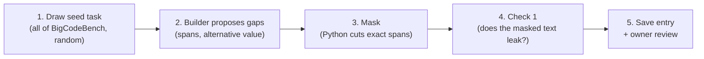

# Stage 1 method, v0

> **Archived on 2026-10-31.** Replaced by Stage 1 v1 in `docs/current/`. Do not act on this file.

This is the Stage 1 method as it stands for pilot v0. I made it from `docs/archive/methodology/stage1_dataset_construction_methodology.md` (S1): I kept what v0 still does, removed what it does not, and marked every change with **v0:**. The last section lists what was removed and when it can come back.

`PILOT_V0_PLAN.md` says *how* an agent builds this. This document says *what* the method is.

---

## How much this differs from S1

| | What |
|---|---|
| **Same** | Start from clear benchmark tasks. Remove exact word spans and keep every other word identical. Use the 3-Question Test to pick details. Check 1 (leakage check) is required, with random option order and the `prior_lean` rule. Keep the full instruction for the control run. |
| **Changed** | Gaps are picked directly, instead of splitting the whole instruction into every fact. Masking is done by a Python program. Single-gap versions only, one per gap. A gap that fails Check 1 is rejected. The "readable decision" rule is now "the choice is visible in the code or output". |
| **Removed** | All labels (Category, Crucial/Non-Crucial, Answer Source). Running any code or tests in Stage 1, including the test run on each gap. World gaps. Multi-gap versions. Distractors. Step 5 (extra gaps). Checks 2, 3, 4. The NLI signal. |
| **Moved to Stage 2** | Finding which value an agent used. A judge reads the agent's code and output. Stage 1 makes no statement about how agents will act or how their code will look. |

### Step mapping

| S1 step | v0 |
|---|---|
| 1. Select seed tasks | **Step 1**, narrowed to BigCodeBench with a random draw |
| 2. Split into atomic subparts | **Step 2**, replaced by "the builder proposes up to 3 gaps" |
| 3. Label each subpart | **Removed** |
| 4. Mask | **Step 3** |
| 5. Find extra gaps | **Removed** |
| 6. Quality checks | **Step 4**, Check 1 only |
| 7. Dataset entry | **Step 5** |

---

## Overview of the pipeline



**Running example.** BigCodeBench/985 is used throughout. Its full instruction contains this sentence:

> *"If this function encounters a float population that is otherwise valid, it will **round it down to the nearest integer**."*

---

## Step 1: Select Seed Tasks

Do not start from vague prompts. Start from **clear, fully specified tasks** from an existing benchmark.

**v0:**
- **Source:** BigCodeBench v0.1.4 only. Each task has an instruction, reference code written by the benchmark authors, and unit tests.
- **No filter:** every task is eligible. There is no keyword filter and no library filter. The builder decides which tasks have a usable gap, and the share it skips is itself a result.
- **Draw:** 20 seeds at random from all tasks, with a fixed random seed. Nobody picks them by hand.
- **No code is run in Stage 1.** The builder reads the reference code, but nothing executes it. Checking that each task's reference code passes its own tests (the "reference check") moves to Stage 2, which must set up BigCodeBench's environment anyway so agents can run their code.

The four rules from S1:

1. **Multi-Step Execution.** **v0: relaxed.** Each BigCodeBench task is one function. We accept this as a known limit of v0.
2. **Grading Checklist Exists.** **v0:** every BigCodeBench task has unit tests, but Stage 1 does not run them. Stage 2 uses them.
3. **Room to Assume and Act.** Unchanged. See the 3-Question Test below.
4. **Mix of Details.** **v0: removed.** v0 does not label gaps as World, User, or Task.

### Rule 3 in Practice: The 3-Question Test

The removed detail must be a **setting** of the task, not its **goal**. Ask three questions:

1. **Is It Still the Same Task?** Remove the detail and read the instruction again. If the job changed or disappeared, the item fails.
2. **Is There a Short List of Reasonable Values?** There are about 2–5 realistic values, and you could write a working solution for each one.
3. **Would a Good Engineer Start Working?** Without the detail, a competent developer would make a sensible pick and keep going, instead of getting stuck.

If all three answers are **Yes**, the item passes Rule 3. In v0, the builder applies this test (Step 2), and you check it again in the review sheet.

#### Coding Instructions That Pass

| Type | Example Detail | Realistic Values |
| :--- | :--- | :--- |
| **Settings with Common Defaults** | Key size, port, timeout, retry count, log level, encoding, CSV delimiter | `2048` / `4096`; `8080` / `8000`; `UTF-8` / `Latin-1` |
| **Edge-Case Policy** | Missing values, bad input, duplicates, existing output file | Drop / fill; raise error / return `None`; keep first / keep last; overwrite / skip |
| **Output Contract** | Return type, file format, sort order, time zone, rounding | List / generator; JSON / CSV; UTC / local |

**v0:** S1 also listed Scope, Environment facts, and User facts. BigCodeBench tasks do not contain them.

#### Coding Instructions That Fail

| Type | Example | Why It Fails |
| :--- | :--- | :--- |
| **The Detail Is the Goal** | *"Implement Dijkstra"* → *"Implement an algorithm"* | There is no task left. |
| **Puzzle Limits** | Removing an input size or the exact output rule from a LiveCodeBench-style problem | The problem becomes unsolvable, not ambiguous. |
| **Made-Up Names with No Convention** | The exact column name `total_price_usd`, a specific URL, a filename the user invented | No default exists. The agent can only make a random guess, so RQ3 has nothing to measure. |
| **Choices You Cannot See** | Two algorithms that produce the same code shape and the same output | **v0:** nobody could tell from the agent's work which value it used. (S1 judged this with the tests; v0 judges it by whether the choice is visible in code or output.) |

---

## Step 2: The Builder Proposes Gaps

**v0: this replaces S1 Step 2 ("Break the Instruction into Atomic Subparts") and S1 Step 3 ("Label Each Subpart").**

S1 split the whole instruction into every single fact, gave each one three labels, and then chose which to remove. Most facts in an instruction ("use Python", "the function is called `task_func`") can never be gaps, so most of that work was wasted. v0 gives no labels at all.

In v0, one model call (the **builder**) reads the full instruction and the reference code. It then either proposes **up to 3 gaps** that pass the 3-Question Test, or says to skip the seed. It must not pick a detail where the reference code does something different from what the instruction says. (BigCodeBench/232 has such a mismatch: the instruction says ties go to the alphabetically first category, but the code picks the first one it sees.)

For each gap, the builder gives:

| Field | Meaning | 985 example |
|---|---|---|
| `variable` | Short name for the detail | `population_rounding` |
| `spans_removed` | **Every** exact place in the instruction that states the detail, including default values in the function signature. Same rule as S1. | `["round it down to the nearest integer"]` |
| `replaced_with` | Neutral text for each span, in the same order. It also fixes any grammar the cut breaks. | `["convert it to an integer"]` |
| `original_value` | The value in the full instruction | `round down` |
| `alternative_values` | **v0: exactly one** realistic other value (S1: one or more) | `["round to the nearest integer"]` |

The exact prompt is in `prompts_v0.md`.

---

## Step 3: Create the Ambiguous Instructions (Surgical Masking)

### Rules for Masking

1. **Do Not Rewrite the Whole Prompt.** Unchanged: cut out only the exact word spans, cut **all** spans of the gap, and keep every other word **100% identical**.
   - **v0:** a Python program does the cut (`str.replace`) with the builder's spans and replacement texts. No language model edits the text, so no other word can change by accident. A grammar fix is part of the replacement text.
   - If a span is not found word for word in the instruction, the gap is rejected. There is no second try.
2. **Masking Modes.**
   - **v0: Single-Gap Mode only.** Each gap gets its own masked instruction. A seed with 2 gaps gives 2 masked instructions.
   - **Not in v0:** Multi-Gap Mode and distractors.
3. **Keep the Full Instruction.** Unchanged. Stage 2 runs it as the control run (Branch B-Full).
4. **Store the Hidden Truth.** **v0:** BigCodeBench has no files or databases to look in, so only the user can know the removed detail. In Stage 2, the removed value goes only to the User Simulator. Nothing is placed in the environment.

**985 example.** The masked instruction reads:

> *"If this function encounters a float population that is otherwise valid, it will **convert it to an integer**."*

Every other character is identical to the full instruction.

---

## Step 4: Quality Check (Check 1 Only)

**v0:** only Check 1. Checks 2, 3, and 4 are not done in Stage 1 (see the last section).

### Check 1: No-Hints-Left-Behind Test (Zero Leakage)

A blind reader (a language model) reads the masked instruction. It picks the original value, the alternative value (in **random order**), or "undetermined". It must also list any clue words it used.

**Why it is required.** A leaked mask breaks the item for all five RQs, because the agent does not need to assume anything. It is also the cheapest check: one model call per gap.

**Rules:**
- **Pass:** Unchanged. The reader picks "undetermined", **or** it picks a value but lists **no** clue spans. A pick with no clue spans is a **prior lean** (the reader's general sense of the usual default), not a leak. Record it as `prior_lean` and keep the item.
- **Fail:** **v0: any listed clue span fails the gap automatically.** In the review sheet you can override a fail to a pass, and you write the reason. *(S1: a reviewer first decides whether the clue is real.)*
- **After a fail:** **v0: reject the gap.** Do not mask again. *(S1: mask the clue too, or reject.)*
- **Random order:** Unchanged. Shuffle which value appears first, and store the order so the script can map the answer back.
- **What the reader sees:** **v0:** the whole masked instruction, including the function signature at the end. That is exactly what an agent will see; default argument values in the signature can leak a value.
- **NLI model:** **v0: not used.**

### Supporting Literature (Check 1)

| Citation | What It Supports |
| :--- | :--- |
| Poliak et al., *SEM 2018 — [Hypothesis Only Baselines in Natural Language Inference](https://aclanthology.org/S18-2023/) | A model that sees only part of the input can still guess the answer from leftover word clues. Our blind reader tests for this. |
| Gururangan et al., NAACL 2018 — [Annotation Artifacts in Natural Language Inference Data](https://aclanthology.org/N18-2017/) | Same idea: leftover word patterns can give away the answer. |

> **Open item (from S1):** No citation yet supports the core method of cutting details from clear tasks. LHAW, Ambig-DS, and Ambig-SWE are named as precedents. Verify them before citing.

---

## Step 5: Dataset Entry (JSON Schema)

**v0:** the structure is S1's, so the Stage 2 prompts that expect `reference_ambiguities` still work. Each entry is single-gap, so the list has one item.

```json
{
  "task_id": "BigCodeBench/985::single::population_rounding",
  "seed_task_id": "BigCodeBench/985",
  "source": {"benchmark": "BigCodeBench", "version": "v0.1.4", "instruction_sha256": "..."},
  "full_instruction": "... it will round it down to the nearest integer. ...",
  "masked_instruction": "... it will convert it to an integer. ...",
  "masking_mode": "single_gap",
  "reference_ambiguities": [
    {
      "subpart_id": "gap_1",
      "variable": "population_rounding",
      "spans_removed": ["round it down to the nearest integer"],
      "replaced_with": ["convert it to an integer"],
      "answer_source": "User",
      "is_crucial": true,
      "original_value": "round down",
      "alternative_values": ["round to the nearest integer"],
      "leakage_check": {
        "result": "pass",
        "reader_choice": "undetermined",
        "option_order": ["alternative_value", "original_value"],
        "leftover_clue_spans": []
      }
    }
  ],
  "extra_gaps": [],
  "review": {"owner_verdict": null, "owner_note": null}
}
```

### Field Notes

Same as S1:
- `spans_removed` / `replaced_with`: lists in the same order. One gap can have several spans.
- `original_value` / `alternative_values`: we do **not** label either one as the "default" before the runs. RQ3 measures the default.
- `leakage_check`: the result of Check 1. `"note": "prior_lean"` means the reader picked a value with no clue spans.

Changed or new in v0:
- `masking_mode`: always `"single_gap"`.
- `alternative_values`: exactly one item.
- `answer_source` and `is_crucial`: **fixed values** (`"User"`, `true`). They are not labels; nobody decides them. They stay only because two Stage 2 prompts read them: the User Simulator reads `answer_source`, and the Branch A judge reads `is_crucial`.
- `source`: benchmark, version, and a hash of the original instruction, so the seed can be traced back.
- `extra_gaps`: always empty.
- `review`: your keep/drop verdict from the review sheet.
- **Removed:** `category`, `crucial_evidence`, `linked_decisions`.

---

## What Stage 2 will do with an entry

This is outside v0. It is recorded here so the Stage 1 output fits what Stage 2 needs. Stage 1 makes no prediction about what agents will do; how to read an agent's code is decided when the Stage 2 judge is designed.

Stage 2 gives the masked instruction to an agent. It then needs to know **which value the agent used**, for RQ3 and RQ4. In v0 this comes from a judge (a language model) that reads:

| Question | What the judge reads |
|---|---|
| Which value did the agent use? (RQ3) | The agent's **code and output** |
| Did the agent notice the gap? (RQ1) | Its questions, its lookups, its hedging, and its reasoning trace **when the model shows one** |
| Did it tell the user? (RQ4) | Its **final message** |

The value comes from the code and output, **not** from the reasoning trace, for three reasons:
- many models hide or summarize their reasoning;
- what a model says it does and what its code does can differ;
- RQ4 compares the agent's report with what it actually did, so "what it did" must not come from its own words.

Because a judge can misread code, a human spot-check of the judge (S1 Check 4 / playbook Part 4) is **required before publication**, not optional.

---

## Not in v0, and when it comes back

| Removed | Why it is safe to skip now | When it comes back |
|---|---|---|
| Splitting the whole instruction into facts (S1 Step 2, Prompts 1A–1C) | v0 only needs the gaps it masks | If the User Simulator needs a full list of user facts (with World gaps) |
| Category labels (S1 Step 3A) | Nothing in v0 depends on them; they can be added to existing gaps later without masking again | When other benchmarks add User and World gaps, and RQ1a (recall by category) is measured |
| Crucial / Non-Crucial (S1 Step 3B) | Every v0 gap is a reference gap; there are no distractors | With distractors |
| The test run on each gap (S1 Step 3B) | Stage 2 reads the agent's code instead of running tests. The test run also could not see choices the tests skip (for example, sort order in BigCodeBench/96) | If you want to claim that silent assumptions make tasks fail; or if the Stage 2 judge proves unreliable on code |
| Answer Source (S1 Step 3C) | No environment in BigCodeBench, so the answer is always "the user" | With World gaps (Terminal-Bench, WorkBench, etc.) |
| World gaps and the W-Absent setup | Same | Same |
| Non-Crucial distractors (S1 Step 4) | Not needed for the pilot | Before RQ1b precision results are reported |
| Multi-gap mode (S1 Step 4) | Single-gap gives a clean one-to-one result first | After v0 works; on a chosen subset |
| Extra gaps (S1 Step 5, Prompt 1E) | The Stage 2 judge still marks such questions `real_unmasked_gap` | Before RQ1b precision results are reported |
| Check 2 (completeness) | Only needed when splitting into all facts | With full splitting |
| Check 3 (3-model voting) | Only checks labels, which v0 does not have | With the labels |
| Check 4 (human spot-check, 50–100 items, κ) | You review every gap in the pilot instead (not a random sample, no κ) | Before publication; it also has to cover the Stage 2 judge |
| NLI second signal for Check 1 | Optional in S1 | If Check 1 proves unreliable |
| Re-masking after a Check 1 fail | Rejection shows how often leaks happen | If the leak rate is high enough to matter |
| `linked_decisions` | Only RQ5 uses it | With RQ5 |
| Reference check (each task's correct code passes its own tests) | Nothing in Stage 1 needs it; it was the only reason Stage 1 needed BigCodeBench's environment | Stage 2, before agents run a task, in Stage 2's environment |
