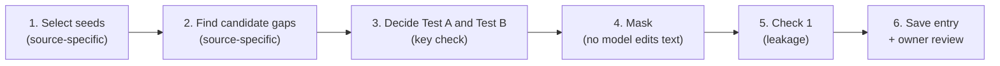

# Stage 1 method (v1, draft)

> **Status: draft, not in force.** The active plan is still `PILOT_V0_PLAN.md` with `stage1_method_v0.md`. This file becomes active only when the owner adopts a v1 plan. Items marked **Open decision** are not decided yet.

This is the general Stage 1 method. It applies to every source benchmark. It says **what** each dataset item must be and **what** must be recorded. How each benchmark meets these rules is in `sources/<benchmark>.md`. How an agent builds the data is in the pilot plan.

---

## 1. Definitions

These follow the project definition (Notion page "Agent's assumptions", revised draft 2026-10-30).

- **Underspecified task:** a delegated task that leaves key choices unresolved.
- **Unresolved choice:** a variable the task needs, where the available information does not fix the value.
- **Available information:** the instruction, the environment the agent can inspect, and any answers the user gives. General conventions are not available information.
- **Key choice:** an unresolved choice that passes Test A and Test B (Section 3).
- **Gap:** one detail that Stage 1 removes from a clear task to create one unresolved choice.
- **Original value:** the value the full instruction states. It stands for what the user wants.
- **Alternative value:** one other realistic value for the same choice.

---

## 2. Pipeline



Steps 1 and 2 differ by source. Steps 3 to 6 follow the same rules for every source.

---

## 3. Gap criteria

### Test A: Can the task be done under either value?

Could a working solution be written for the original value, and another for the alternative value, with the available information? Answer **yes** or **no**.

Test A excludes gaps that **block** the task: without the detail, the agent cannot complete the task at all.

### Test B: Do the two values give different content, not only a different form?

Convert both results to the same form: the same container, file format, style, or wording. Do the results still differ, in data, numbers, selections, actions, or meaning? Answer **yes** or **no**.

Test B excludes **packaging** gaps: return container (tuple / list), exception class name, file format, plot styling, display format, notification channel.

### Fail rules (unchanged from v0)

| Fails | Example | Why |
|---|---|---|
| The detail is the goal | "Implement Dijkstra" → "Implement an algorithm" | No task is left |
| Made-up name with no convention | A specific file name or URL the user invented | The agent can only guess at random (but see the must-ask kind below) |
| Choice you cannot see | Two values that give the same code shape and the same result | Stage 2 cannot tell which value the agent used |

### Gap kinds

Every candidate gap gets exactly one kind.

| Kind | Rule | Used for |
|---|---|---|
| `key` | Passes Test A and Test B | The reference set for RQ1–RQ4 |
| `must_ask` | Fails Test A only because the value is known only to the user (who to invite, a new name, a threshold) | A reference group for RQ2 (asking). Not used for RQ3 defaults |
| `negative_control` | Passes Test A, fails Test B (packaging only) | Optional. Later, as distractors for RQ1b precision |
| `reject` | Anything else | Not saved as an item; logged in `rejected.jsonl` |

### How Test A and Test B may be decided

Each source uses one or more of these methods. Every entry records which one was used.

| Method | What happens | When to use it |
|---|---|---|
| `owner_rule` | The owner decides the kind once for a whole slot or field type, in writing | Templated sources (WorkBench) and structured fields (TravelPlanner) |
| `outcome_comparison` | Compute the correct outcome under each value, from the source's own ground-truth logic or database, and compare | When the source makes this cheap and deterministic |
| `verifier` | A model from a **different model family** than the gap proposer answers Test A and Test B (yes / no, with a reason). The owner reviews a sample, and agreement is reported | Free-text sources with a builder (BigCodeBench) |

> **Open decision (D8).** v0 says "Stage 1 runs no task code". `outcome_comparison` runs a source's data code (for example, WorkBench's pandas outcome functions). It does not run agent code or unit tests. The owner decides whether this is allowed.

---

## 4. Visibility

A gap is **visible** when the masked instruction still shows that a choice exists. A gap is **hidden** when the masked instruction gives no sign that anything is missing.

| | Visible | Hidden |
|---|---|---|
| Example | "Push back my meeting **a bit**"; "convert it to an integer" | The sentence "we need accommodations that allow pets" is deleted |
| What it measures | How the agent handles a choice it can see | Whether the agent questions facts nobody stated |

Deleting a qualifier can make a **different clear task**, not an underspecified one. Example: "Cancel my meetings on Friday before 2" → "Cancel my meetings on Friday" reads as "cancel all of them". For a visible gap, the replacement text must keep the choice visible (for example, "Cancel some of my meetings on Friday").

> **Open decision (visibility).** Recommendation: visible gaps only for the next pilot; hidden gaps later as a separate condition. Visible and hidden items are never pooled in one analysis.

---

## 5. Masking

1. **No model edits the instruction.** A Python program either replaces exact spans (`str.replace`) or renders a masked template with the task's own slot values.
2. **Every other character stays identical** to the full instruction.
3. **Remove every place** that states or hints at the value, including function signatures and default arguments.
4. **The replacement text** is neutral and, for a visible gap, keeps the choice visible. It also repairs grammar.
5. **One gap per item** (single-gap mode). Multi-gap mode is not in v1.
6. **Keep the full instruction.** Stage 2 runs it as the control (Branch B-Full).
7. If a span is not found word for word, or a rendered full template does not reproduce the original text exactly, the gap is rejected.

---

## 6. Alternative value

- Exactly one alternative per gap.
- It must be realistic, and it must pass Test A.
- Each source states **where alternatives come from** (the slot's own value list, the field's categories, or the builder). Alternatives from a source's own value list are preferred over model-written ones.

---

## 7. Check 1: leakage (unchanged from v0)

A blind reader (a language model) sees only the masked instruction. It picks the original value, the alternative value (in random order), or "undetermined", and lists any clue words.

- **Pass:** "undetermined", or a pick with **no** clue spans. A pick with no clue spans is recorded as `prior_lean`.
- **Fail:** any clue span. The gap is rejected. The owner may override with a written reason.
- **Scope:** Check 1 reads the instruction only. An answer that the environment holds on purpose (for example, order history) is **not** a leak. Whether the environment holds the answer is recorded separately as `answer_source`.

Supporting literature: Gururangan et al. (NAACL 2018), Poliak et al. (\*SEM 2018).

> **Open decision (reader model).** The builder and the reader were the same model family in v0. Recommendation: the Check 1 reader and the `verifier` come from a different family than any model that proposes gaps.

---

## 8. Answer source

Now a real field, not a fixed value.

| Value | Meaning |
|---|---|
| `user` | Only the user knows the value |
| `world` | The environment holds the value (a record, file, or profile the agent can read) |
| `both` | Both the user and the environment can supply it |

For `world` and `both`, the source file says where the value is stored. The W-Present / W-Absent switch (the value is or is not in the environment) is not in v1.

---

## 9. The contract: what every item must record

| Field | Meaning |
|---|---|
| `source` | Benchmark, pinned version, split, seed ID |
| `full_instruction`, `masked_instruction` | The two texts |
| `masking` | Spans removed and replacements, **or** the full and masked templates and slot values |
| `original_value`, `alternative_values` | One alternative |
| `alternative_origin` | Where the alternative came from |
| `gap_kind` | `key`, `must_ask`, or `negative_control` |
| `visibility` | `visible` or `hidden` |
| `key_check` | Test A and Test B answers, the method, and its evidence |
| `answer_source` | `user`, `world`, or `both` |
| `leakage_check` | Check 1 result |
| `observable` | Where Stage 2 sees the decision (`code_output`, `db_state`, or `plan`), and the expected outcome under each value when the source can compute it |
| `review` | Owner verdict and note |

### JSON schema

The list `reference_ambiguities` stays, so the Stage 2 prompts that read it still work. `is_crucial` is now derived: `true` only when `gap_kind` is `key`.

```json
{
  "task_id": "<source>/<seed_id>::single::<variable>",
  "seed_task_id": "<seed_id>",
  "source": {"benchmark": "...", "version": "...", "split": "...", "instruction_sha256": "..."},
  "full_instruction": "...",
  "masked_instruction": "...",
  "masking_mode": "single_gap",
  "visibility": "visible",
  "reference_ambiguities": [
    {
      "subpart_id": "gap_1",
      "variable": "...",
      "gap_kind": "key",
      "masking": {
        "spans_removed": ["..."], "replaced_with": ["..."],
        "full_template": null, "masked_template": null, "slot_values": null
      },
      "original_value": "...",
      "alternative_values": ["..."],
      "alternative_origin": "slot_value_list | field_categories | builder",
      "key_check": {
        "test_a": true, "test_b": true,
        "method": "owner_rule | outcome_comparison | verifier",
        "evidence": "..."
      },
      "answer_source": "user",
      "is_crucial": true,
      "leakage_check": {
        "result": "pass", "reader_choice": "undetermined",
        "option_order": ["alternative_value", "original_value"],
        "leftover_clue_spans": []
      },
      "observable": {
        "where": "code_output | db_state | plan",
        "expected_outcomes": {"original": null, "alternative": null}
      }
    }
  ],
  "extra_gaps": [],
  "review": {"owner_verdict": null, "owner_note": null}
}
```

---

## 10. How Stage 2 uses an entry

Stage 2 gives the masked instruction to an agent, then finds **which value the agent used** from its work, never from its own words:

| `observable.where` | How the value is found |
|---|---|
| `code_output` | A judge reads the agent's code and output (BigCodeBench) |
| `db_state` | Compare the final environment state with `expected_outcomes` (WorkBench). No judge is needed |
| `plan` | Run the source's constraint checker on the plan under each value (TravelPlanner) |

Stated assumptions come only from the agent's words: its questions, its visible reasoning, its final report.

---

## 11. Sources

| Source | File | How gaps are found | Key check method |
|---|---|---|---|
| BigCodeBench | `sources/bigcodebench.md` | A builder model proposes gaps | `verifier` |
| WorkBench | `sources/workbench.md` | Template slots (`sources/workbench_slots.csv`) | `owner_rule`, plus `outcome_comparison` if D8 allows |
| TravelPlanner | `sources/travelplanner.md` | Structured constraint fields | `owner_rule`, plus a database check for Test A |

To add a source, add one file under `sources/` with the same seven headings.

---

## 12. Open decisions

| ID | Question | Recommendation |
|---|---|---|
| Visibility | Visible gaps only, or visible and hidden? | Visible only for the next pilot |
| D8 | May Stage 1 run a source's ground-truth data code (not agent code)? | Yes, for `outcome_comparison` |
| Reader model | Which model family for Check 1 and the verifier? | A different family from any gap proposer |
| One-way constraints | How to use filter constraints whose compliance can happen by chance (TravelPlanner house rule, transportation)? | A separate group, reported apart from distinct-value gaps |
| WorkBench slot kinds | Which slots are `key`, `must_ask`, `negative_control`? | Owner fills `sources/workbench_slots.csv` |

---

## 13. Not in v1

Unchanged from `stage1_method_v0.md` ("Not in v0, and when it comes back"), except:

- **Answer source** is back (Section 8).
- **A key check** is back, as Test A and Test B (Section 3). It replaces the old Crucial / Non-Crucial label.
- **Negative controls** can now come from `negative_control` gaps.

Still not in v1: hidden gaps (unless the owner decides otherwise), multi-gap mode, W-Absent, extra-gap search, Checks 2 and 3, RQ5 linked decisions.
