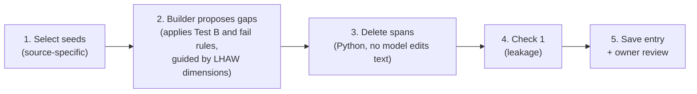

# Stage 1 method (v1)

> **Status: in force** (adopted 2026-10-31). The build plan is `PILOT_V1_PLAN.md` and the prompts are in `prompts_v1.md`. Items marked **Open decision** are not decided yet. The v0 method is archived in `../archive/v0/stage1_method_v0.md`.

This is the general Stage 1 method. It applies to every source benchmark. It says **what** each dataset item must be and **what** must be recorded. How each benchmark meets these rules is in `sources/<benchmark>.md`. How an agent builds the data is in the pilot plan.

---

## 1. Definitions

These follow the project definition (Notion page "Agent's assumptions", revised draft 2026-10-30).

- **Underspecified task:** a delegated task that leaves key choices unresolved.
- **Unresolved choice:** a variable the task needs, where the available information does not fix the value.
- **Available information:** the instruction, the environment the agent can inspect, and any answers the user gives. General conventions are not available information.
- **Key choice:** an unresolved choice that passes Test B and no fail rule (Section 3).
- **Gap:** one detail that Stage 1 deletes from a clear task to create one unresolved choice.
- **Original value:** the value the full instruction states. It stands for what the user wants.
- **Alternative value:** one other realistic value for the same choice.

---

## 2. Pipeline



Step 1 differs by source. The builder (step 2) reads source-specific inputs, listed in each source file. Steps 3 to 5 are the same for every source.

**No task code runs in Stage 1** (decision D8, kept on 2026-10-30). The builder reads the task, its reference solution or stored outcome, and its data. Nothing executes them.

---

## 3. Gap criteria (part of the builder prompt)

The builder applies these rules itself when it proposes gaps. There is no separate verifier step (decided 2026-10-30). The owner reviews the result.

### Test B: Do the two values give different content, not only a different form?

Convert both results to the same form: the same container, file format, style, or wording. Do the results still differ, in data, numbers, selections, actions, or meaning? Answer **yes** or **no**.

Test B excludes **packaging** gaps: return container (tuple / list), exception class name, file format, plot styling, display format, notification channel.

*(The name "Test B" is kept from earlier drafts. A "Test A", which excluded gaps that block the task, was removed on 2026-10-30: gaps that block the task are welcome, because the agent must then ask or assume something to finish.)*

### Fail rules

| Fails | Example | Why |
|---|---|---|
| The detail is the goal | "Implement Dijkstra" → "Implement an algorithm" | No task is left: the agent would be doing a different job, not filling in a missing detail |
| Choice you cannot see | Two values that give the same code shape and the same result | Stage 2 cannot tell which value the agent used |

Details only the user knows (who to invite, a new file name, a threshold) are allowed. RQ1, RQ2, and RQ4 work for them as usual; for RQ3 there may be no common default to compare across agents.

### Guidance for the builder: LHAW's dimensions

To point the builder at the details worth deleting, the builder prompt includes the four dimensions of missing information from LHAW ([arXiv 2602.10525](https://arxiv.org/abs/2602.10525), ICLR 2026):

| LHAW dimension | LHAW definition | Builder rule |
|---|---|---|
| Goal | The deliverable or success criteria are unclear | **Never delete.** This is the "detail is the goal" fail rule |
| Constraint | The rules, thresholds, or methods are unclear: the agent knows what to do but not the parameters | **Look here first.** Most good gaps are constraints |
| Input | The data source, file, system, or tool is unclear | Allowed |
| Context | Domain knowledge, jargon, or implicit requirements are unclear | Allowed when it changes content (Test B) |

The builder records the dimension of each gap (`lhaw_dimension`). The finer decision-type taxonomy (Scope, Method, and so on) is **not** given to the builder; it is applied after the build (`stage3_taxonomy.md`).

---

## 4. Masking: delete

Decided 2026-10-30: **gaps are made by deleting the detail**, not by replacing it with vague words. This is LHAW's *Delete* strategy.

1. **No model edits the instruction.** A Python program deletes the builder's exact spans (`str.replace` with an empty string).
2. **Delete every place** that states or hints at the value, including function signatures and default arguments.
3. **Replacement text only to repair grammar,** when a deletion leaves a broken sentence. It must add no information and no hint. Most gaps need no replacement at all.
4. **Every other character stays identical** to the full instruction.
5. **One gap per item** (single-gap mode). Multi-gap mode is not in v1.
6. **Keep the full instruction.** Stage 2 runs it as the control (Branch B-Full).
7. If a span is not found word for word, the gap is rejected.

**Why delete.** A deleted detail can leave an instruction that reads as complete. Example: "Cancel my meetings on Friday before 2" → "Cancel my meetings on Friday". This is intended: a careful agent should still ask "all of them, or which ones?". Whether agents question such instructions is part of what the study measures.

---

## 5. Alternative value

- Exactly one alternative per gap, proposed by the builder.
- It must be realistic: a reasonable user could have meant it.
- When the source has its own list of values (for example, WorkBench's generator lists), the builder should prefer a value from it, and the source file says where the list is.

---

## 6. Check 1: leakage (unchanged from v0)

A blind reader (a language model) sees only the masked instruction. It picks the original value, the alternative value (in random order), or "undetermined", and lists any clue words.

- **Pass:** "undetermined", or a pick with **no** clue spans. A pick with no clue spans is recorded as `prior_lean`.
- **Fail:** any clue span. The gap is rejected. The owner may override with a written reason.
- **Scope:** Check 1 reads the instruction only. An answer that the environment holds on purpose (for example, order history) is **not** a leak. Whether the environment holds the answer is recorded separately as `answer_source`.

Supporting literature: Gururangan et al. (NAACL 2018), Poliak et al. (\*SEM 2018).

> **Open decision (Check 1 reader).** Which model reads in Phase 2, and whether it differs from the builder's model family. The dry run used Claude Opus 5.5 (high effort), provisionally; the builder is GPT-6.1 Sol (high effort).

---

## 7. Answer source

A real field, not a fixed value.

| Value | Meaning |
|---|---|
| `user` | Only the user knows the value |
| `world` | The environment holds the value (a record, file, or profile the agent can read) |
| `both` | Both the user and the environment can supply it |

For `world` and `both`, the source file says where the value is stored. The W-Present / W-Absent switch (the value is or is not in the environment) is not in v1.

---

## 8. The contract: what every item must record

| Field | Meaning |
|---|---|
| `source` | Benchmark, pinned version, split, seed ID |
| `full_instruction`, `masked_instruction` | The two texts |
| `spans_removed`, `replaced_with` | The deleted spans; replacement text only where grammar needed it (otherwise `""`) |
| `original_value`, `alternative_values` | One alternative |
| `lhaw_dimension` | `constraint`, `input`, or `context` |
| `key_check` | The builder's Test B answer and one-sentence reason |
| `answer_source` | `user`, `world`, or `both` |
| `leakage_check` | Check 1 result |
| `observable` | Where Stage 2 sees the decision (`code_output` or `db_state`), and the source's stored outcome for the original value when it has one |
| `review` | Owner verdict and note |

### JSON schema

The list `reference_ambiguities` stays, so the Stage 2 prompts that read it still work. `is_crucial` stays fixed at `true`: every saved gap has passed Test B.

```json
{
  "task_id": "<source>/<seed_id>::single::<variable>",
  "seed_task_id": "<seed_id>",
  "source": {"benchmark": "...", "version": "...", "split": "...", "instruction_sha256": "..."},
  "full_instruction": "...",
  "masked_instruction": "...",
  "masking_mode": "single_gap_delete",
  "reference_ambiguities": [
    {
      "subpart_id": "gap_1",
      "variable": "...",
      "spans_removed": ["..."],
      "replaced_with": [""],
      "original_value": "...",
      "alternative_values": ["..."],
      "lhaw_dimension": "constraint",
      "key_check": {"test_b": true, "reason": "..."},
      "answer_source": "user",
      "is_crucial": true,
      "leakage_check": {
        "result": "pass", "reader_choice": "undetermined",
        "option_order": ["alternative_value", "original_value"],
        "leftover_clue_spans": []
      },
      "observable": {"where": "code_output | db_state", "original_outcome": null}
    }
  ],
  "extra_gaps": [],
  "review": {"owner_verdict": null, "owner_note": null}
}
```

---

## 9. How Stage 2 uses an entry

Stage 2 gives the masked instruction to an agent, then finds **which value the agent used** from its work, never from its own words:

| `observable.where` | How the value is found |
|---|---|
| `code_output` | A judge reads the agent's code and output (BigCodeBench) |
| `db_state` | Compare the final environment state with the stored outcome for the original value (WorkBench). Because Stage 1 runs no code, the outcome for the alternative value is not precomputed; Stage 2 decides how to identify it |

Stated assumptions come only from the agent's words: its questions, its visible reasoning, its final report.

---

## 10. Sources

| Source | File | What the builder reads |
|---|---|---|
| BigCodeBench | `sources/bigcodebench.md` | Instruction and reference code |
| WorkBench | `sources/workbench.md` | Instruction, its template, the stored outcome, and the relevant database records |
| Gaia2 (ARE), execution split | `sources/gaia2.md` | Instruction, its correct actions, and the app records they touch |

TravelPlanner was dropped on 2026-10-30. Its draft is in `docs/archive/v1_drafts/travelplanner.md`.

To add a source, add one file under `sources/` with the same seven headings.

---

## 11. Decisions

**Decided (2026-10-30):**

| Decision | Outcome |
|---|---|
| Masking | Delete the detail; replacement text only to repair grammar |
| D8 | Kept: no task code runs in Stage 1 |
| Verifier | None. Test B is in the builder prompt; the owner reviews |
| Builder guidance | LHAW's four dimensions are in the builder prompt; the finer taxonomy stays in Stage 3 |
| TravelPlanner | Dropped |
| Assistant source | Gaia2 (ARE), execution split. Candidates compared: τ²-bench, MultiWOZ via ToolWOZ |
| Test A, gap kinds, made-up-name fail rule | Removed |

**Decided (2026-10-30 to 2026-10-31, during pilot v1 Phase 1):**

| Decision | Outcome |
|---|---|
| WorkBench version | `top_level` (the upstream README's current ground truth). Also exclude rows whose outcome differs in either dated snapshot: 554 eligible tasks. See `sources/workbench.md` |
| Gaia2 pin | Revision `78ea3bdbdeec2bdcd6afa5420915d8a22f23ed99`, downloaded to `data/raw/gaia2/` |
| Gaia2 invitations to ask | Exclude scenarios whose instruction invites the agent to ask (one found) |
| Draw sizes | 60 BigCodeBench, 30 WorkBench (at most 6 per domain), 30 Gaia2 |
| Location of a `world` / `both` value | Written in `key_check.reason`; no separate field |

**Open:**

| ID | Question | Status |
|---|---|---|
| Check 1 reader | Which model reads in Phase 2, and is it a different family from the builder? | Owner names it before Phase 2 (dry run used Claude Opus 5.5, provisionally) |

---

## 12. Not in v1

Unchanged from `../archive/v0/stage1_method_v0.md` ("Not in v0, and when it comes back"), except:

- **Answer source** is back (Section 7).
- **Test B** is back, inside the builder prompt (Section 3). It replaces the old Crucial / Non-Crucial label.
- **Made-up names** are allowed (Section 3).
- **Masking deletes** instead of replacing with neutral text (Section 4).

Still not in v1: multi-gap mode, W-Absent, extra-gap search, Checks 2 and 3, RQ5 linked decisions.
